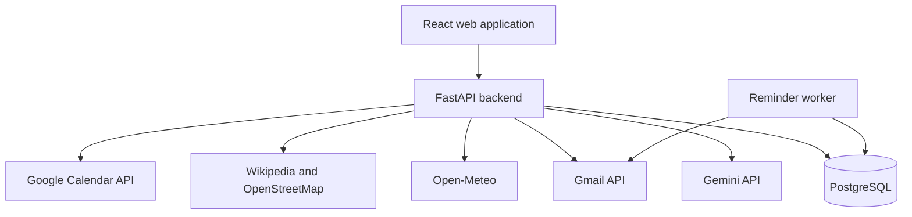

# Travel Planning Chatbot — Product Requirements Document

- **Version:** 1.0
- **Date:** 20 October 2026
- **Status:** Agreed scope; implementation pending
- **Platform:** Responsive web application

## 1. Product overview

Build a conversational travel assistant that helps users discover destinations,
check weather, explore attractions, create itineraries, and prepare packing
checklists. Users can save plans, send approved itineraries through Gmail, and
add approved activities to Google Calendar.

V1 uses open-source software and eligible free API tiers. Free services have
quotas and terms; unlimited free usage and always-on free hosting are not promised.
This document defines the target product, not features already implemented in
the existing demo scaffold.

## 2. Goals and target users

- Make travel planning accessible through natural conversation.
- Ground recommendations in retrieved destination, attraction, and weather data.
- Personalize plans around dates, budget, interests, and companions.
- Support preparation, saved plans, email delivery, and reminders.

Target users are individual travelers, students, families, and small groups
planning leisure trips. Each trip belongs to one account; shared editing is
outside V1.

## 3. Core user journey

1. Sign in and start a trip conversation.
2. Specify a destination or ask for destination suggestions.
3. Supply missing dates, time zone, budget, interests, and companion details.
4. Receive destination information, available forecasts, and attractions.
5. Review a proposed day-by-day itinerary and packing checklist.
6. Refine the plan through follow-up messages and save it.
7. Optionally connect Google and approve an email or calendar export.
8. Configure reminders, revisit plans, and cancel pending application reminders.

Example: “Plan a three-day Jaipur trip in December. I like historical places,
have a moderate budget, and want a packing checklist.”

## 4. Functional requirements

### 4.1 Accounts and Google authorization

- Support Google sign-in through a maintained authentication implementation.
- Request Gmail and Calendar scopes only when users enable those features.
- Support planning and saving without Gmail or Calendar authorization.
- Enforce account ownership for trips, conversations, and integration records.
- Allow users to disconnect integrations and delete application-held data.

### 4.2 Conversational planning

- Accept natural-language requests and retain context within a trip conversation.
- Collect destination, dates, duration, departure location when relevant, budget,
  currency, interests, companions, and travel time zone.
- Ask focused questions when required details are missing.
- Resolve ambiguous locations and dates before scheduling external actions.
- Allow preferences to change without restarting the conversation.

### 4.3 Destination discovery

- Provide destination summaries and reference links.
- Suggest destinations based on user preferences.
- Ask users to disambiguate places with similar names.
- Label recommendations as suggestions, not confirmed availability.

### 4.4 Weather

- Retrieve forecasts for supported locations and dates.
- Display location, dates, units, source, and retrieval time.
- Explain when requested dates fall outside the forecast window.
- Distinguish general seasonal guidance from retrieved forecasts.
- Never invent a forecast when live data is unavailable.

### 4.5 Attractions and nearby services

- Retrieve attractions, descriptions, coordinates, and source links where available.
- Find nearby restaurants, accommodation locations, pharmacies, and useful services.
- Display opening hours only when supported by source data.
- Explain incomplete coverage and missing information.
- Do not claim current prices, ratings, booking availability, or opening hours
  without supporting data.

### 4.6 Personalized itineraries

- Generate day-by-day plans from dates, interests, budget, and available weather.
- Group nearby activities where practical and include breaks.
- Label visit durations and travel times as estimates unless appropriately sourced.
- Suggest alternatives when weather makes an activity unsuitable.
- Support adding, removing, replacing, and reordering activities.
- Preserve itinerary revisions when saved plans change.
- Treat budget guidance as approximate; verified booking totals are outside V1.

### 4.7 Packing and preparation

- Suggest items based on destination, duration, activities, and available weather.
- Group items into clothing, documents, electronics, health essentials, and
  activity-specific equipment.
- Persist users' packed/unpacked progress.
- Suggest checking reservations, transport, and official travel requirements.
- Link to authoritative sources when available; do not present personalized
  visa, medical, or entry advice as verified.

### 4.8 Saved trips

- List, view, rename, update, and delete trips.
- Persist preferences, conversations, itinerary revisions, and packing progress.
- Record which revision was emailed or exported to Calendar.
- Do not silently synchronize itinerary changes to external calendars.

### 4.9 Gmail delivery

- Send approved itineraries and checklists from the connected Gmail account to
  that same account in V1.
- Preview recipient, subject, and content before the first send.
- Require explicit confirmation or a previously approved reminder schedule.
- Track delivery state and provider identifiers when available.
- Explain failed authorization, quota exhaustion, and unsuccessful sends.
- Request send permission only; do not read the user's inbox.

### 4.10 Google Calendar

- Preview proposed events and require approval before creating, changing, or
  deleting them.
- Include activity title, date, time, time zone, location, and description.
- Configure reminders based on the user's approved preferences.
- Persist external event identifiers and prevent duplicate creation on retries.
- Modify only events created by this application.
- Reading unrelated events and checking calendar conflicts are outside V1.

### 4.11 Scheduled email reminders

- Schedule emails before departure or itinerary activities.
- Confirm exact date, time, time zone, and recipient.
- List and cancel pending reminders.
- Update affected pending reminders after users approve schedule changes.
- Track pending, processing, sent, failed, and cancelled states.
- Use bounded retries for temporary failures and duplicate-processing protection.
- Application email reminders require a running backend worker. Google Calendar
  reminders operate separately after events have been created.

## 5. Technology stack

| Component | V1 choice | Purpose |
| --- | --- | --- |
| Frontend | React, Vite, TypeScript | Responsive chat and trip management |
| Styling | Tailwind CSS | Consistent interface styling |
| Backend | Python, FastAPI | Application API and integration orchestration |
| Database | PostgreSQL | Persistent user, trip, conversation, and reminder data |
| Database access | SQLAlchemy, Alembic | Data access and schema migrations |
| LLM | Google Gemini API | Tool selection and grounded answer generation |
| Authentication | Google Identity Services / OAuth | Sign-in and delegated Google authorization |
| Scheduling | Dedicated Python worker with PostgreSQL-backed jobs | Persistent reminders; one worker initially |
| Testing | pytest, Playwright | Backend integration and browser workflow tests |

No vector database is required. PostgreSQL is the application database, not an
external information API. OpenAI API is not part of the agreed V1 stack.

## 6. Third-party APIs

| Service | Use | Constraints |
| --- | --- | --- |
| Google Gemini API | Understand requests and generate plans from retrieved data | Select an eligible free-tier model; verify current model, regional, quota, and data-handling terms |
| Open-Meteo | Weather forecasts | Confirm eligibility, usage limits, and attribution terms |
| Wikipedia / MediaWiki | Destination summaries and references | Follow attribution and content licensing requirements |
| OpenStreetMap Overpass | Attractions and nearby services | Respect public endpoint policies, attribution, caching, and incomplete coverage |
| Gmail API | Approved email delivery | OAuth authorization, sending quotas, and possible verification requirements |
| Google Calendar API | Approved events and reminders | OAuth authorization, quotas, and duplicate prevention |
| Google Identity Services / OAuth | Identity and authorization | Separate sign-in permissions from Gmail/Calendar permissions |

API pricing, free-tier availability, and policies must be checked before
implementation and public launch. This PRD does not certify current provider terms.

## 7. Architecture and AI behavior

- The backend owns API calls, validates tool arguments, and enforces permissions.
- Gemini may request approved tools; it cannot bypass backend authorization.
- Never expose API keys or OAuth tokens to the model or browser.
- Treat retrieved content as data, not instructions.
- Distinguish retrieved facts, estimates, suggestions, and unavailable information.
- Include relevant sources and provide partial answers when a provider fails.
- Require appropriate approval before email delivery or Calendar changes.

## 8. Data model

| Entity | Main information |
| --- | --- |
| User | Identity, email, preferences, default time zone |
| Google connection | Scopes, encrypted credentials, expiry, connection status |
| Trip | Owner, destination, dates, budget, currency, preferences, time zone |
| Conversation/message | Trip, role, content, timestamps |
| Itinerary revision | Version, plan, sources, creation time |
| Activity | Revision, location, timing, source references |
| Packing item | Category, description, packed status |
| Reminder | Trigger time, recipient, state, attempt count, trip/activity |
| Email delivery | Content revision, state, provider identifier |
| Calendar mapping | Activity, calendar/event identifiers, synchronization state |

Store instants in UTC and preserve the trip's IANA time-zone identifier for
display and scheduling.

## 9. Nonfunctional requirements

### Security and privacy

- Keep secrets server-side; encrypt stored OAuth credentials.
- Exclude credentials and unnecessary personal information from logs.
- Check ownership on every saved resource and use HTTPS in deployment.
- Minimize personal data sent to Gemini and review free-tier data-handling terms.
- Provide integration disconnection and deletion of application-held user data.

### Reliability

- Set timeouts and bounded retries on external requests.
- Persist reminder jobs across restarts.
- Prevent duplicate Calendar creation and duplicate reminder processing.
- Surface provider errors without crashing the conversation.
- Do not promise exactly-once email delivery when provider outcomes are ambiguous.

### Usability and performance

- Support mobile/desktop layouts, keyboard navigation, and accessible labels.
- Provide loading, empty, success, partial-data, and error states.
- Show progress promptly while external requests run.
- Retrieve independent information concurrently where appropriate.
- Measure actual latency before setting production response-time guarantees.

## 10. Zero-cost operating requirements

- Use open-source components and eligible free service tiers.
- Do not activate paid APIs or billing automatically.
- Explain exhausted quotas and offer retry guidance.
- Cache public information where provider terms permit.
- Use local PostgreSQL for predictable zero-payment development; hosted free
  plans are optional and subject to their own limits.
- Decide hosting separately. Always-on workers may not fit free hosting tiers.
- Do not promise unlimited usage or uninterrupted free cloud operation.

## 11. Out of scope

- Flight, hotel, and attraction booking or payments.
- Guaranteed live pricing or availability.
- Turn-by-turn navigation and verified route optimization.
- Gmail inbox access and unrelated Calendar event access.
- Shared itinerary editing, group accounts, and calendar conflict detection.
- SMS, WhatsApp, and voice interfaces.
- Autonomous external actions without required user approval.
- A production availability guarantee.

## 12. Acceptance criteria

1. A user can sign in and create a trip through chat.
2. Destination, attraction, and available weather information is retrieved.
3. The user receives an itinerary and packing checklist with relevant sources.
4. Follow-up edits preserve relevant context and saved itinerary revisions.
5. Trips and packing progress persist across sessions.
6. An approved itinerary can be emailed through the connected Gmail account.
7. Approved activities can be exported to Calendar without duplicates on retry.
8. A scheduled reminder is processed while the worker runs and can be cancelled
   before sending.
9. Provider failures and exhausted quotas produce truthful, useful responses.
10. Users cannot access other users' trips or credentials.
11. Automated tests cover planning, ownership, provider failures, reminders, and
    duplicate prevention.
12. The validated development workflow requires no paid service.

## 13. Delivery phases

| Phase | Deliverables |
| --- | --- |
| 1 — Foundation | Frontend, FastAPI, PostgreSQL, authentication, trip storage |
| 2 — Travel planning | Gemini, weather, destination/attraction retrieval, itineraries |
| 3 — Personalization | Follow-up editing, saved revisions, packing progress |
| 4 — Google integrations | Gmail delivery and Calendar export |
| 5 — Reminders and validation | Persistent worker, retries, cancellation, security and end-to-end checks |

## 14. Decisions before implementation

- Exact Gemini model and current free-tier eligibility and data terms.
- Local development versus hosted deployment and worker availability.
- Authentication implementation, OAuth scopes, and Google verification needs.
- Geographic coverage and acceptable completeness of attraction data.
- Overpass endpoint policy, caching strategy, and source attribution presentation.
- Data-retention period and account-deletion behavior.

These decisions refine implementation without expanding the agreed V1 scope.
