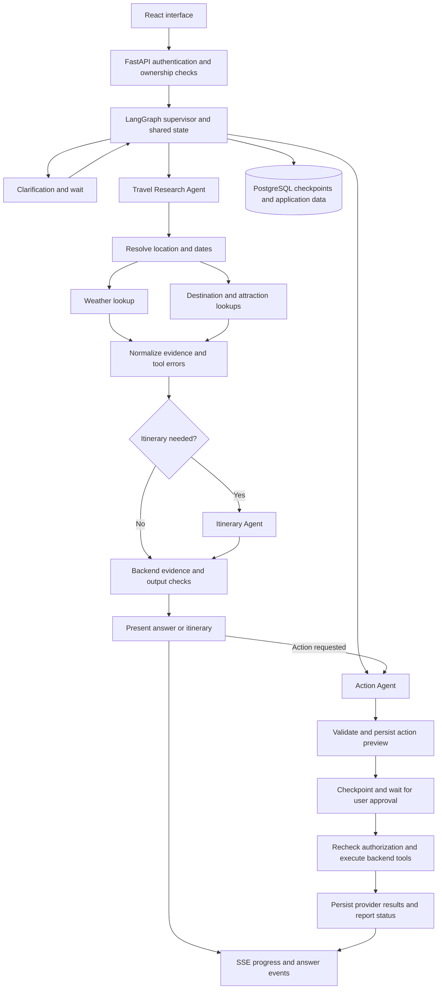

# Travel Planning Chatbot — Product Requirements Document

- **Version:** 1.0
- **Finalized:** 21 October 2026
- **Status:** Final V1 product and architecture baseline; implementation pending
- **Platform:** Responsive web application

## 1. Product overview

Build a conversational travel assistant that helps users discover destinations,
check weather, explore attractions, create itineraries, and prepare packing
checklists. Users can save plans, send approved itineraries through Gmail, and
add approved activities to Google Calendar.

The application uses three specialist AI agents orchestrated with LangGraph.
LangChain provides the Gemini integration, tool definitions, and structured
outputs. Agent orchestration, streamed progress, and approval-based execution
are required V1 capabilities.

V1 uses open-source software and eligible free API tiers. Free services have
quotas and terms; unlimited free usage and always-on free hosting are not promised.
This document defines the target product, not currently implemented capabilities.

## 2. Goals and target users

- Make travel planning accessible through natural conversation.
- Ground recommendations in retrieved destination, attraction, and weather data.
- Personalize plans around dates, budget, interests, and companions.
- Support preparation, saved plans, email delivery, and reminders.

Target users are individual travelers, students, families, and small groups
planning leisure trips. Each trip belongs to one account; shared editing is
outside V1.

## 3. Core user journey

1. Sign in and start a trip conversation.
2. Specify a destination or ask for destination suggestions.
3. Supply missing dates, time zone, budget, interests, and companion details.
4. Receive destination information, available forecasts, and attractions.
5. Review a proposed day-by-day itinerary and packing checklist.
6. Refine the plan through follow-up messages and save it.
7. Optionally connect Google and approve an email or calendar export.
8. Configure reminders, revisit plans, and cancel pending application reminders.

Example: “Plan a three-day Jaipur trip in December. I like historical places,
have a moderate budget, and want a packing checklist.”

## 4. Functional requirements

### 4.1 Accounts and Google authorization

- Support Google sign-in through a maintained authentication implementation.
- Request Gmail and Calendar scopes only when users enable those features.
- Support planning and saving without Gmail or Calendar authorization.
- Enforce account ownership for trips, conversations, and integration records.
- Allow users to disconnect integrations and delete application-held data.

### 4.2 Conversational planning

- Accept natural-language requests and retain context within a trip conversation.
- Collect destination, dates, duration, departure location when relevant, budget,
  currency, interests, companions, and travel time zone.
- Ask focused questions when required details are missing.
- Resolve ambiguous locations and dates before scheduling external actions.
- Allow preferences to change without restarting the conversation.

### 4.3 Destination discovery

- Provide destination summaries and reference links.
- Suggest destinations based on user preferences.
- Ask users to disambiguate places with similar names.
- Label recommendations as suggestions, not confirmed availability.

### 4.4 Weather

- Retrieve forecasts for supported locations and dates.
- Display location, dates, units, source, and retrieval time.
- Explain when requested dates fall outside the forecast window.
- Distinguish general seasonal guidance from retrieved forecasts.
- Never invent a forecast when live data is unavailable.

### 4.5 Attractions and nearby services

- Retrieve attractions, descriptions, coordinates, and source links where available.
- Find nearby restaurants, accommodation locations, pharmacies, and useful services.
- Display opening hours only when supported by source data.
- Explain incomplete coverage and missing information.
- Do not claim current prices, ratings, booking availability, or opening hours
  without supporting data.

### 4.6 Personalized itineraries

- Generate day-by-day plans from dates, interests, budget, and available weather.
- Group nearby activities where practical and include breaks.
- Label visit durations and travel times as estimates unless appropriately sourced.
- Suggest alternatives when weather makes an activity unsuitable.
- Support adding, removing, replacing, and reordering activities.
- Preserve itinerary revisions when saved plans change.
- Treat budget guidance as approximate; verified booking totals are outside V1.

### 4.7 Packing and preparation

- Suggest items based on destination, duration, activities, and available weather.
- Group items into clothing, documents, electronics, health essentials, and
  activity-specific equipment.
- Persist users' packed/unpacked progress.
- Suggest checking reservations, transport, and official travel requirements.
- Link to authoritative sources when available; do not present personalized
  visa, medical, or entry advice as verified.

### 4.8 Saved trips

- List, view, rename, update, and delete trips.
- Persist preferences, conversations, itinerary revisions, and packing progress.
- Record which revision was emailed or exported to Calendar.
- Do not silently synchronize itinerary changes to external calendars.

### 4.9 Gmail delivery

- Send approved itineraries and checklists from the connected Gmail account to
  that same account in V1.
- Preview recipient, subject, and content before the first send.
- Require explicit confirmation or a previously approved reminder schedule.
- Track delivery state and provider identifiers when available.
- Explain failed authorization, quota exhaustion, and unsuccessful sends.
- Request send permission only; do not read the user's inbox.

### 4.10 Google Calendar

- Preview proposed events and require approval before creating, changing, or
  deleting them.
- Include activity title, date, time, time zone, location, and description.
- Configure reminders based on the user's approved preferences.
- Persist external event identifiers and prevent duplicate creation on retries.
- Modify only events created by this application.
- Reading unrelated events and checking calendar conflicts are outside V1.

### 4.11 Scheduled email reminders

- Schedule emails before departure or itinerary activities.
- Confirm exact date, time, time zone, and recipient.
- List and cancel pending reminders.
- Update affected pending reminders after users approve schedule changes.
- Track pending, processing, sent, failed, and cancelled states.
- Use bounded retries for temporary failures and duplicate-processing protection.
- Application email reminders require a running backend worker. Google Calendar
  reminders operate separately after events have been created.

### 4.12 Agent orchestration

- Implement exactly three specialist agents for V1: Travel Research, Itinerary,
  and Action. A supervisor/router node coordinates them; it is not a fourth
  specialist agent.
- Invoke only the agents required by a request. A weather question must not
  invoke itinerary generation or action preparation.
- Execute independent retrieval tools concurrently after resolving location
  and date dependencies.
- Persist workflow state and support clarification, approval pauses, and resume.
- Bound agent handoffs, tool calls, retries, execution time, and model usage.
- Agents share validated trip state and evidence, not credentials or unrestricted
  access to one another's tools.

### 4.13 Streaming and workflow visibility

- Stream authenticated workflow events from FastAPI to React using SSE framing.
- Show useful progress such as researching attractions or preparing an itinerary.
- Stream user-facing answer text and distinguish draft content from completed,
  validated answers. Draft text cannot trigger external actions.
- Display sources, partial failures, approval requests, completion, and errors.
- Reconnect to an existing run without starting duplicate work or repeating actions.
- Never stream private model reasoning, prompts, credentials, or raw tool payloads.

## 5. Technology stack

| Component | V1 choice | Purpose |
| --- | --- | --- |
| Frontend | React, Vite, TypeScript | Responsive chat and trip management |
| Styling | Tailwind CSS | Consistent interface styling |
| Backend | Python, FastAPI | Application API and integration orchestration |
| Database | PostgreSQL | Persistent user, trip, conversation, and reminder data |
| Database access | SQLAlchemy, Alembic | Data access and schema migrations |
| LLM | Google Gemini API | Tool selection and grounded answer generation |
| Agent orchestration | LangGraph | Routing, parallel branches, durable state, interrupts, and resume |
| LLM and tool integration | LangChain with Gemini integration | Agent messages, typed tools, structured outputs, and supported streaming |
| Workflow persistence | LangGraph PostgreSQL checkpointer | Durable graph checkpoints, separate from application records |
| Streaming | FastAPI with SSE-framed responses | Progress, answer text, approvals, and run status |
| Authentication | Google Identity Services / OAuth | Sign-in and delegated Google authorization |
| Scheduling | Dedicated Python worker with PostgreSQL-backed jobs | Persistent reminders; one worker initially |
| Testing | pytest, Playwright | Backend integration and browser workflow tests |

No vector database is required. PostgreSQL is the application database, not an
external information API. OpenAI API is not part of the agreed V1 stack.

## 6. Third-party APIs

| Service | Use | Constraints |
| --- | --- | --- |
| Google Gemini API | Understand requests and generate plans from retrieved data | Select an eligible free-tier model; verify current model, regional, quota, and data-handling terms |
| Open-Meteo | Weather forecasts | Confirm eligibility, usage limits, and attribution terms |
| Open-Meteo Geocoding | Resolve destination candidates and coordinates | Verify coverage and terms; ask users to resolve ambiguity |
| Wikipedia / MediaWiki | Destination summaries and references | Follow attribution and content licensing requirements |
| OpenStreetMap Overpass | Attractions and nearby services | Respect public endpoint policies, attribution, caching, and incomplete coverage |
| Gmail API | Approved email delivery | OAuth authorization, sending quotas, and possible verification requirements |
| Google Calendar API | Approved events and reminders | OAuth authorization, quotas, and duplicate prevention |
| Google Identity Services / OAuth | Identity and authorization | Separate sign-in permissions from Gmail/Calendar permissions |

API pricing, free-tier availability, and policies must be checked before
implementation and public launch. This PRD does not certify current provider terms.

## 7. Architecture and agent behavior

### 7.1 Agent responsibilities

| Agent | Responsibility | Allowed capabilities |
| --- | --- | --- |
| Travel Research Agent | Resolve locations, retrieve destination/attraction/weather evidence, summarize research | Read-only geocoding, Wikipedia, Overpass, and forecast tools |
| Itinerary Agent | Generate or revise day plans and packing lists from preferences and evidence | Read relevant trip data and produce structured proposals; no external writes |
| Action Agent | Prepare email, Calendar, and reminder proposals from the selected itinerary revision | Read approved trip context and prepare typed action proposals; execution remains backend-controlled |

All three agents may use the same Gemini model and server-side API binding.
Separate agents have distinct instructions and tool permissions; they do not
require separate model providers or API keys. A graph node is not necessarily
an agent or an LLM call.

The supervisor/router uses deterministic routes for explicit UI operations and
structured Gemini routing for ambiguous conversational requests. It checks
required fields before dispatching and asks clarifying questions where needed.
The Research Agent can answer a simple factual question directly after evidence
validation. Saved-plan actions can bypass research and itinerary generation.

### 7.2 Graph flow

Independent lookups run concurrently only after prerequisite inputs are known.
The research branch uses bounded fan-out and merges results without concurrent
writes overwriting shared state. Provider errors become explicit result records;
one failed provider does not silently erase successful evidence.

### 7.3 Tool contracts and API adapters

- Define typed inputs and outputs using validated schemas and LangChain tools.
- Restrict requests to configured provider endpoints; do not accept arbitrary
  URLs, SQL, or executable code from model output.
- Include normalized location, requested dates, source IDs, retrieval time,
  relevant facts, and error/availability state in retrieval results.
- Apply provider timeouts, bounded retries, response-size limits, caching rules,
  and rate limits. Respect attribution and usage policies.
- Separate action proposal tools from privileged execution functions. Model
  output alone cannot authorize an external write.
- Store OAuth credentials in a protected backend service; agents receive only
  connection status and permitted capabilities.

### 7.4 Shared state and durable execution

Persist user-scoped conversation/run identifiers, trip ID, preferences, resolved
location and time zone, evidence references, itinerary revision, agent/tool
outcomes, usage counters, pending action references, and workflow status.
Keep domain records authoritative; checkpoints must reference their versions.
Never store credentials in graph state.

Use PostgreSQL-backed LangGraph checkpoints to resume clarification and approval
interrupts. Check ownership on every start, stream, cancel, and resume request.
Prevent competing runs from overwriting the same itinerary revision. A checkpoint
restart must not replay a completed email or Calendar mutation.

### 7.5 Approval and external actions

- Persist an immutable proposal containing action type, recipient or target,
  payload hash, itinerary revision, user, expiry, and status.
- Present the exact proposal and accept approval through an authenticated request.
- Invalidate approval when its payload or itinerary revision changes.
- Revalidate permissions, connection state, proposal status, and ownership at
  execution time, not only when the agent creates the proposal.
- Use a durable action ledger and stable idempotency identifiers. Record partial
  success when multiple events are created and retry only known failed operations.
- Treat ambiguous Gmail outcomes as uncertain; do not blindly resend because a
  timeout occurred. Do not claim guaranteed exactly-once delivery.
- Report email acceptance by Gmail separately from confirmed recipient delivery.
- Reminders use previously approved schedules. A deterministic background worker,
  not an autonomous agent loop, claims and executes due jobs.

### 7.6 Streaming contract

Use a POST request to start a run and return its identifier, then an authenticated
GET stream for SSE events. Approval, cancellation, and resume use separate
mutating endpoints. Support authentication without placing tokens in URLs.

Events include run and event IDs, type, time, and a minimal payload. Types include
progress, answer delta, sources, approval required, partial failure, completed,
and error. Support heartbeat and bounded replay or a current-state snapshot on
reconnect. A dropped stream does not restart the run or authorize an action.

Validate structured plans and evidence before presenting them as final. Draft
answer tokens must be visibly provisional; if final validation fails, replace
or retract the draft with a clear corrected result. Stream only user-facing
content, never internal reasoning or unrestricted tool output.

### 7.7 Guardrails and evidence grounding

| Boundary | Required controls |
| --- | --- |
| Input | Authentication, ownership, size limits, date/location clarification |
| Routing | Allowed agents, structured decisions, handoff and usage budgets |
| Tools | Schema checks, provider allowlist, least privilege, deadlines, rate limits |
| Retrieved content | Treat text as untrusted data; ignore embedded instructions |
| Output | Source-reference checks, forecast-window checks, date consistency, itinerary overlaps, explicit estimates |
| External actions | Exact previews, durable approval, authorization recheck, duplicate prevention |
| Persistence and logs | User isolation, secret exclusion, deletion coverage, minimal personal data |

Store evidence with provider, source URL or record ID, retrieval time, geographic
scope, date range, and normalized facts. Source availability is evidence rather
than an absolute truth guarantee. Explain stale, incomplete, and conflicting
information. Do not invent sources or facts to fill gaps.

Distinguish factual claims from generated advice. Validate factual support
against evidence records. Another LLM's agreement is not proof of correctness;
optional model review cannot replace source checks or deterministic validation.
If validation fails, allow at most a bounded repair attempt and otherwise return
an honest partial answer or clarification.

### 7.8 Chunking, embeddings, and memory

V1 uses live structured API retrieval and requires no document chunking, embedding
model, vector database, or retrieval-augmented document pipeline. Normalize weather
and attraction data into records. Keep recent conversation turns plus structured
trip state and, where needed, a bounded summary.

If long-document search is approved later, consider heading-aware chunks around
400–800 tokens with 50–100 token overlap, then tune using retrieval evaluation.
Evaluate an eligible Gemini embedding model and PostgreSQL pgvector at that time;
use compatible document/query embeddings and re-embed when changing models.
These are future options, not V1 dependencies.

## 8. Data model

| Entity | Main information |
| --- | --- |
| User | Identity, email, preferences, default time zone |
| Google connection | Scopes, encrypted credentials, expiry, connection status |
| Trip | Owner, destination, dates, budget, currency, preferences, time zone |
| Conversation/message | Trip, role, content, timestamps |
| Itinerary revision | Version, plan, sources, creation time |
| Activity | Revision, location, timing, source references |
| Packing item | Category, description, packed status |
| Reminder | Trigger time, recipient, state, attempt count, trip/activity |
| Email delivery | Content revision, state, provider identifier |
| Calendar mapping | Activity, calendar/event identifiers, synchronization state |
| Evidence record | Provider, source reference, retrieval time, location/date scope, normalized facts |
| Workflow run/checkpoint | User-scoped run/thread ID, state version, status, usage, checkpoint reference |
| Action proposal/approval | Exact payload hash, target, itinerary revision, owner, expiry, approval state |
| Action execution | Stable operation key, provider result, attempts, partial/uncertain outcome |
| Stream event | Run ID, sequence/event ID, safe event payload, retention metadata |

Store instants in UTC and preserve the trip's IANA time-zone identifier for
display and scheduling.

## 9. Nonfunctional requirements

### Security and privacy

- Keep secrets server-side; encrypt stored OAuth credentials.
- Exclude credentials and unnecessary personal information from logs.
- Check ownership on every saved resource and use HTTPS in deployment.
- Minimize personal data sent to Gemini and review free-tier data-handling terms.
- Provide integration disconnection and deletion of application-held user data.

### Reliability

- Set timeouts and bounded retries on external requests.
- Persist reminder jobs across restarts.
- Prevent duplicate Calendar creation and duplicate reminder processing.
- Surface provider errors without crashing the conversation.
- Do not promise exactly-once email delivery when provider outcomes are ambiguous.

### Usability and performance

- Support mobile/desktop layouts, keyboard navigation, and accessible labels.
- Provide loading, empty, success, partial-data, and error states.
- Show progress promptly while external requests run.
- Retrieve independent information concurrently where appropriate.
- Measure actual latency before setting production response-time guarantees.
- Track time to first progress, time to first answer token, total response time,
  agent/tool duration, routing accuracy, provider errors, and model usage.
- Avoid invoking all agents for every request. Set configurable run budgets and
  handle Gemini throttling with bounded backoff and useful partial results.
- Provide local structured traces; paid tracing or hosted LangGraph services are
  not required. Redact personal data and credentials from traces.

## 10. Zero-cost operating requirements

- Use open-source components and eligible free service tiers.
- Do not activate paid APIs or billing automatically.
- Explain exhausted quotas and offer retry guidance.
- Cache public information where provider terms permit.
- Use local PostgreSQL for predictable zero-payment development; hosted free
  plans are optional and subject to their own limits.
- Decide hosting separately. Always-on workers may not fit free hosting tiers.
- Do not promise unlimited usage or uninterrupted free cloud operation.

## 11. Out of scope

- Flight, hotel, and attraction booking or payments.
- Guaranteed live pricing or availability.
- Turn-by-turn navigation and verified route optimization.
- Gmail inbox access and unrelated Calendar event access.
- Shared itinerary editing, group accounts, and calendar conflict detection.
- SMS, WhatsApp, and voice interfaces.
- Autonomous external actions without required user approval.
- A production availability guarantee.
- Document uploads, vector search, and embedding infrastructure.
- A fourth verification agent or unconstrained autonomous agent conversations.

## 12. Acceptance criteria

1. A user can sign in and create a trip through chat.
2. Destination, attraction, and available weather information is retrieved.
3. The user receives an itinerary and packing checklist with relevant sources.
4. Follow-up edits preserve relevant context and saved itinerary revisions.
5. Trips and packing progress persist across sessions.
6. An approved itinerary can be emailed through the connected Gmail account.
7. Approved activities can be exported to Calendar without duplicates on retry.
8. A scheduled reminder is processed while the worker runs and can be cancelled
   before sending.
9. Provider failures and exhausted quotas produce truthful, useful responses.
10. Users cannot access other users' trips or credentials.
11. Automated tests cover planning, ownership, provider failures, reminders, and
    duplicate prevention.
12. The validated development workflow requires no paid service.
13. Three specialist agents run through LangGraph using LangChain/Gemini bindings;
    tests show weather-only requests bypass itinerary and action agents.
14. Independent weather and place tools execute concurrently after location
    resolution; an individual failure produces a labelled partial response.
15. Clarification and approval interrupts survive process restart without losing
    user scope or replaying completed external actions.
16. Users receive progress and final-answer streaming; reconnecting does not create
    a second run, leak another user's events, or duplicate actions.
17. Changed, expired, rejected, or unauthorized proposals cannot execute. Partial
    Calendar success and uncertain Gmail results are reported truthfully.
18. Unsupported source references, unavailable forecast dates, prompt injection
    in retrieved content, and exceeded execution budgets are handled safely.
19. A reproducible evaluation set covers routing, factual support, itinerary
    constraints, tool failures, and action approval. All release-blocking ownership,
    approval, and duplicate-prevention tests must pass; known quality gaps are recorded.

## 13. Delivery phases

| Phase | Deliverables |
| --- | --- |
| 1 — Foundation | React, FastAPI, PostgreSQL, authentication, domain schemas, trip storage |
| 2 — Reliable tools | Typed API adapters, geocoding, evidence records, fixtures, error handling |
| 3 — Agent orchestration | Three agents, LangChain/Gemini integration, LangGraph routing, parallel research, checkpoints, bounded execution |
| 4 — Planning and streaming | Itineraries, packing, follow-up edits, revisions, SSE events, validated final answers |
| 5 — Approved integrations | Gmail/Calendar proposals, durable approvals, execution ledger, duplicate prevention |
| 6 — Reminders and validation | Persistent worker, cancellation, recovery, grounding evaluations, security and browser checks |

Use recorded provider fixtures for reproducible tests and separate live integration
checks for actual provider compatibility. Evaluate routing and answer support
against expected tool choices and evidence, not an LLM judging itself. Measure
latency under representative workloads before setting deployment targets.

## 14. Implementation configuration to finalize

The product scope and three-agent architecture are final for V1. These deployment
and provider choices must still be verified during implementation:

- Exact Gemini model, free-tier eligibility, limits, and data-handling terms.
- Compatible pinned LangGraph, LangChain, Gemini integration, and PostgreSQL
  checkpointer versions after checking official documentation.
- Local versus hosted deployment, worker availability, encryption-key management,
  and supported OAuth callback origins.
- Authentication library, minimal OAuth scopes, and Google verification needs.
- Geographic coverage, geocoder suitability, Overpass endpoint policies, caching,
  and attribution presentation.
- Model/tool/time budgets and timeout settings based on measured API behavior.
- Approval expiry, stream replay retention, checkpoint/evidence retention, and
  account-deletion handling across application data and checkpoint storage.

## 15. Final scope summary

V1 delivers a travel-planning web application with exactly three specialist
agents, LangGraph orchestration, LangChain integrations, Gemini generation,
PostgreSQL persistence, live travel information, streamed responses, and approved
Gmail/Calendar actions. Backend guardrails, evidence grounding, persistent
reminders, and meaningful evaluation are part of delivery, not optional add-ons.
No paid infrastructure, embeddings, or additional agents are required by design;
actual no-cost operation remains subject to verified provider and hosting limits.
