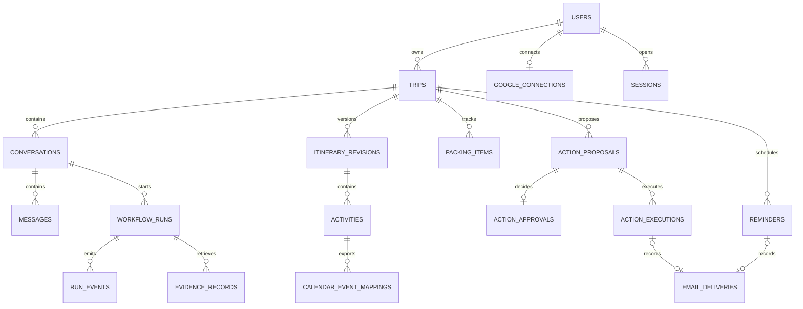

# TripWeave V1 — Database Architecture

- **Version:** 1.0
- **Date:** 22 October 2026
- **Status:** Agreed target design; migrations and full implementation pending
- **Related:** [PRD](../PRD.md), [API architecture](API_ARCHITECTURE.md)

## 1. Scope and deployment

Use one PostgreSQL database for the FastAPI application, LangGraph checkpoints,
and a separate deterministic reminder/action worker. The three agents execute
inside the orchestration service; they are not three independently deployed
microservices. React never accesses PostgreSQL or provider credentials directly.

The target design has **18 application tables**, plus tables managed by the
chosen PostgreSQL LangGraph checkpointer. Keep checkpointer tables in a separate
schema if supported by the selected version; their exact count is not fixed here.

The current starter has only `trips` and `action_proposals`, uses JSON snapshots,
and supports SQLite as a local fallback. It has no user isolation or durable
graph checkpoints. This document is a migration target, not a description of
capabilities already deployed. PostgreSQL is the target for complete V1.

## 2. Storage conventions

- Use UUID primary keys, `timestamptz` for execution/audit times, and UTC instants.
- Store trip-local dates as `date` and retain an IANA time-zone identifier.
- Store money as nonnegative `numeric`, never floating point; retain currency.
- Use explicit columns for ownership, relationships, dates, statuses, and filtering.
- Use JSONB for validated preferences, normalized provider facts, and immutable
  proposal payloads. JSONB must not bypass schema validation or ownership checks.
- Encrypt OAuth credentials using a key managed outside the database. Never put
  tokens in graph checkpoints, messages, evidence, events, or logs.
- Foreign keys and application authorization both apply. A UUID is not permission.
- Keep domain tables authoritative; checkpoints hold resumable execution state.

## 3. Tables and relationships

The fields below define the logical schema. Unless described as optional, required
relationship and identity fields must be non-null. Final migrations must specify
all concrete constraints and deletion behavior.

### 3.1 Accounts — 3 tables

| Table | Fields | Constraints and relationships |
| --- | --- | --- |
| `users` | `id`, `google_subject`, `email`, `display_name`, `default_timezone`, `created_at`, `updated_at`, optional `deletion_requested_at` | Unique Google subject; email is not an ownership key |
| `google_connections` | `id`, `user_id`, granted scopes, encrypted refresh token, optional cached encrypted access token and expiry, status, timestamps | Unique `user_id` in V1; FK to users; sign-in does not imply Gmail/Calendar permission |
| `sessions` | `id`, `user_id`, hashed session token, `expires_at`, optional `revoked_at`, timestamps | Unique token hash; FK to users; never persist the raw cookie token |

Use a Google subject identifier for stable identity even if email changes.
Prefer not to persist short-lived access tokens when refresh-on-demand suffices.

### 3.2 Trips and conversations — 3 tables

| Table | Fields | Constraints and relationships |
| --- | --- | --- |
| `trips` | `id`, `user_id`, title, destination label, optional country/coordinates, optional start/end dates, time zone, optional budget/currency, preferences JSONB, status, timestamps | FK to users; end date cannot precede start date; coordinates must be valid when present |
| `conversations` | `id`, `trip_id`, title, timestamps | FK to trips; one trip can have multiple conversations |
| `messages` | `id`, `conversation_id`, optional `run_id`, role, content, `created_at` | FK to conversations and workflow runs; constrained roles; messages ordered by time plus ID |

Trip drafts may omit dates or coordinates until clarified. Preferences include
interests, companions, mobility considerations, and pacing. Minimize sensitive
information. Create a user message and its workflow run in one transaction.

### 3.3 Itineraries and preparation — 3 tables

| Table | Fields | Constraints and relationships |
| --- | --- | --- |
| `itinerary_revisions` | `id`, `trip_id`, `revision_number`, summary, originating `run_id`, source references, `created_at` | Unique `(trip_id, revision_number)`; immutable after publication |
| `activities` | `id`, `revision_id`, day number, sequence, title, description, optional coordinates/location, optional start/end instants, estimated duration, evidence references | FK to revision; unique `(revision_id, day_number, sequence)`; positive day/duration; valid time range |
| `packing_items` | `id`, `trip_id`, category, description, `is_packed`, timestamps | FK to trip; progress remains trip-level across itinerary revisions |

Editing a plan creates a new revision and new activities. Previously emailed or
exported versions remain identifiable. Resolve local dates/times using the trip
time zone before generating Calendar proposals; clarify ambiguous DST times.
Opening hours and travel durations remain estimates unless supported by evidence.

### 3.4 Orchestration and evidence — 3 tables

| Table | Fields | Constraints and relationships |
| --- | --- | --- |
| `workflow_runs` | `id`, `user_id`, `conversation_id`, request key/hash, status, checkpoint thread ID, input/revision references, usage counters, safe error code, timestamps | Unique `(user_id, request_key)`; bind key to payload hash; FK to owned conversation |
| `run_events` | `run_id`, sequence, event type, safe JSONB payload, `created_at` | Composite primary key `(run_id, sequence)`; FK to run; no secrets or model reasoning |
| `evidence_records` | `id`, `run_id`, provider, source URL/record ID, retrieval time, location/date scope, availability, normalized facts JSONB, attribution metadata | FK to run; preserve original provenance and units |

Run states: `queued`, `running`, `waiting_for_input`, `waiting_for_approval`,
`completed`, `failed`, `cancelled`. Application guards enforce valid transitions.
Resume routes must load the existing run and checkpoint, not create an unrelated
execution. Store evidence IDs in generated outputs and validate their existence
and scope. Referential checks for JSONB references require application validation;
they are not automatic relational foreign keys.

Bound concurrent runs per trip, or use optimistic revision checks, to prevent
one generation from silently overwriting another. Parallel research branches
must merge independent outputs rather than overwrite shared evidence.

### 3.5 Approvals, execution, and reminders — 6 tables

| Table | Fields | Constraints and relationships |
| --- | --- | --- |
| `action_proposals` | `id`, `user_id`, `trip_id`, `revision_id`, optional `run_id`, action type, target, exact payload JSONB, payload hash, expiry, status, timestamps | Immutable content; constrained action types; references must belong to the same user/trip |
| `action_approvals` | `id`, `proposal_id`, `user_id`, decision, decision time | At most one terminal decision per proposal; approver must own proposal |
| `action_executions` | `id`, `proposal_id`, operation key, status, attempt count, claim/lease fields, next attempt time, safe error code, timestamps | Unique operation key; one row per independently retryable operation |
| `calendar_event_mappings` | `id`, `activity_id`, `google_connection_id`, external calendar/event IDs, synchronization status, timestamps | Unique connection/calendar/event combination; validate activity and connection ownership |
| `email_deliveries` | `id`, optional execution ID, optional reminder ID, recipient, provider message ID, status, timestamps | Exactly one origin: execution or reminder; one accepted-send record per origin; no guarantee of receipt/read |
| `reminders` | `id`, `user_id`, `trip_id`, optional activity ID, approved schedule/payload hash, trigger instant, status, attempt count, claim/lease fields, timestamps | FK to owned trip/activity; immutable approved payload per schedule version; reconfirm changes |

Proposal states: `pending`, `approved`, `rejected`, `expired`, `superseded`.
Execution states: `queued`, `processing`, `succeeded`, `failed`, `uncertain`,
`cancelled`. Reminder states: `pending`, `processing`, `sent`, `failed`,
`uncertain`, `cancelled`. Record partial Calendar batches through separate
operation rows rather than representing an entire batch as a single success.

Revised payloads require a new proposal and approval. A valid approval is bound
to owner, target, payload hash, revision, and expiry. A scheduled reminder is
itself an explicitly approved schedule; its worker execution needs no new LLM call.

## 4. Entity relationships

The diagram shows major relationships; the table definitions also specify run,
revision, connection, and ownership references.

## 5. Mapping third-party data

| Provider result | Normalize to | Persist in |
| --- | --- | --- |
| Geocoding | Selected name, country, coordinates, IANA time zone | Trip fields plus evidence |
| Open-Meteo forecast | Daily dates, units, temperature, precipitation, supported date scope | Evidence records |
| Wikipedia summary | Title, excerpt, canonical source link, attribution | Evidence records |
| Overpass place | Provider type/ID, name, category, coordinates, available hours | Evidence; selected snapshot and source IDs in activities |
| Gemini plan | Validated days, activities, suggestions, source IDs | Revision, activities, packing suggestions |
| Gmail response | Accepted state and provider message identifier | Execution and email delivery |
| Calendar response | External calendar/event ID and provider status | Execution and Calendar mapping |

Do not retain arbitrary provider payloads indefinitely. Normalize only needed
fields, cap sizes, and preserve timestamps and source references. API responses
are evidence, not an absolute guarantee of accuracy. Weather, availability, and
opening hours must not be inferred when a provider omits them.

## 6. Transactions and background execution

### Planning

1. Check ownership and idempotency key; atomically create run and user message.
2. Commit before provider calls. Do not hold a transaction while waiting for AI.
3. Retrieve, normalize, and persist evidence; checkpoint execution as needed.
4. Validate generated output and expected trip revision.
5. Atomically save revision, activities, assistant message, and completion state.
6. Publish persisted completion events; recover gaps from authoritative run state.

### Approved actions

1. Save exact proposal and preview; do not execute during generation.
2. In one transaction, validate current proposal and approval, record decision,
   and enqueue execution rows. These rows serve as the transactional work queue.
3. Worker claims due work using row locks such as `FOR UPDATE SKIP LOCKED`,
   records a lease, and commits before calling the provider.
4. Persist provider outcomes and IDs; resume graph status without replaying writes.
5. On worker failure, recover expired leases conservatively. An expired lease
   alone does not prove the provider did not execute the operation.

Use provider-supported stable event IDs for Calendar duplicate prevention.
Gmail timeouts may leave an uncertain outcome; do not blindly resend. Neither a
database transaction nor a LangGraph checkpoint makes a provider call atomic.

Reminder claims and cancellation use conditional state transitions. Report a
conflict if cancellation races with a provider call already in progress. Trip or
account deletion must cancel/revoke pending work before removing its records.

## 7. Indexes, constraints, and isolation

- Index `trips(user_id, created_at, id)` and parent keys used by list APIs.
- Index messages by `(conversation_id, created_at, id)` for cursor pagination.
- Index runs by `(user_id, created_at)` and events by their composite key.
- Index evidence by `run_id`; add JSONB indexes only for measured query needs.
- Index due reminders by `(status, trigger_at)` and queued execution availability.
- Enforce unique revision numbers, request keys, operation keys, and external IDs.
- Validate same-trip and same-owner relationships, using composite constraints
  where practical and transactional backend checks everywhere else.
- Every query derives user scope from the session, not a supplied `user_id`.
- Agents use constrained service methods; never accept model-generated SQL.
- Consider PostgreSQL row-level security as defense in depth after defining the
  connection/session strategy; do not assume it exists in the starter.

## 8. Retention, deletion, and migration

Account deletion revokes sessions and connections, blocks new work, and clears
owned domain data, checkpoints, and stream/evidence records under a documented
policy. Local deletion does not silently delete previously sent emails or Google
events; external deletion requires an explicitly approved operation beforehand.
Remove credentials immediately on disconnect. Any operational retention or backup
window must be disclosed and bounded before public launch.

Introduce Alembic before evolving deployed schemas. Back up current data and
create a tested migration/import path from the two-table starter. Do not reset a
developer's database or assume `create_all()` performs migrations. Add identity
before exposing saved data to multiple users. Test PostgreSQL constraints,
concurrent claims, failed/resumed runs, cross-user access, and deletion behavior.

No embeddings, pgvector, or vector-store schema is required for V1.
